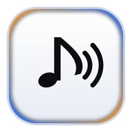
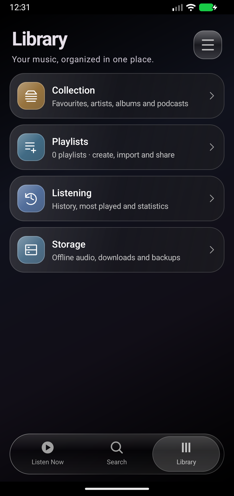
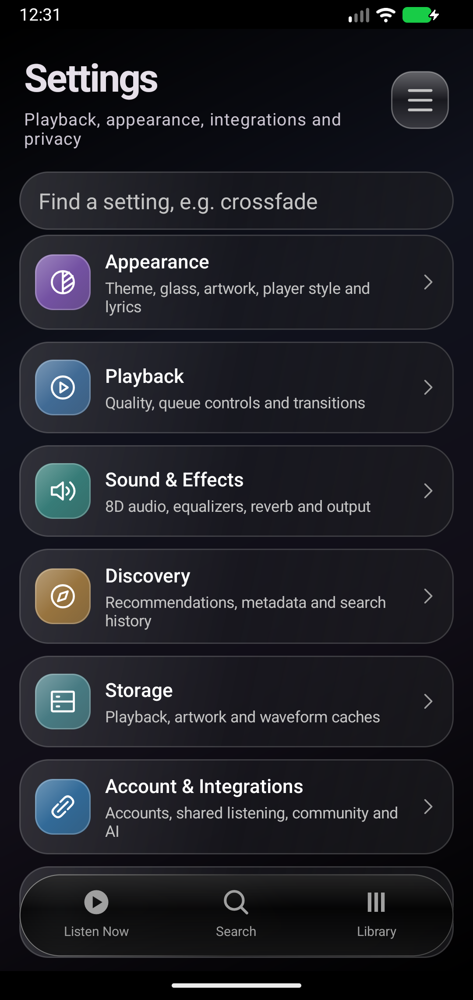
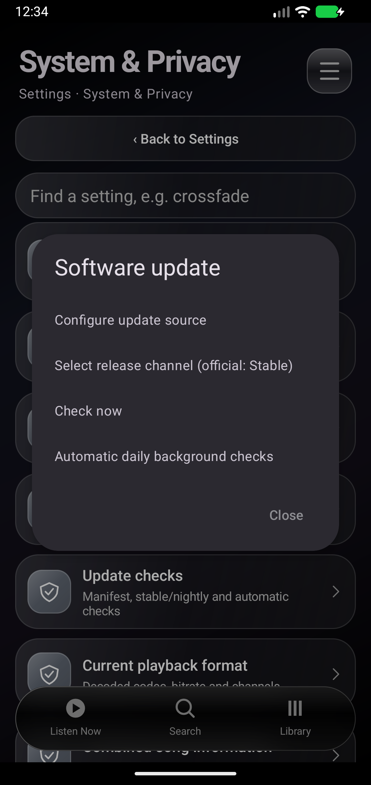

<div align="center">



# GANASUNO

### Your music. Your mood. Your world.

A native Android music player with a premium glass-inspired interface, personalized discovery, offline music tools and advanced audio controls.


**Public launch candidate • v1.1 release not yet published**

[](https://github.com/Abhii-08/GANASUNO/releases)

[Features](#features) · [Installation](#installation) · [Updates](#updates) · [Build from source](#build-from-source) · [Developer](#developer)

<!-- After the repository and first signed release are published, replace the launch-preview text above with the following live release links and badges. Do not show a working download claim until the APK exists.
[](https://github.com/Abhii-08/GANASUNO/actions/workflows/build.yml)
[](https://github.com/Abhii-08/GANASUNO/releases/latest/download/GANASUNO.apk)
[](https://github.com/Abhii-08/GANASUNO/releases/latest)
[](https://github.com/Abhii-08/GANASUNO/releases)
-->

</div>

---

## A better way to listen

GANASUNO brings music discovery, an organized library, expressive Now Playing screens and detailed sound controls together in one Android project. The v1.1 public launch is planned to build on the internal v45.0 development baseline, with release distribution and updater integration added before publication.

## Features

The following describes features present in the development source, not a certification that every feature works on every device. Network-dependent, experimental and planned functions are identified separately below.

### Playback and streaming
- Online music search and playback through existing unofficial integrations; local audio playback and queue restoration.
- Background Media3 playback, media notifications and playback controls.
- Audio/video quality preferences, video player and subtitle support where available.
- Shuffle, smart shuffle, repeat one/all/off, persisted repeat and shuffle preferences.
- Play next, add to queue, reorder and remove tracks; seed-based radio/mix and optional endless queue continuation.
- Playback speed, pitch, skip silence, preferred audio language, explicit-content filtering based on available metadata.
- Sleep timer (duration or end of track), fade in/out, configurable transitions and experimental crossfade/DJ filters.
- Saved listening position and retry/preloading tools.

### Sound and audio effects
- Ten-band software equalizer, Flat/Bass/Vocal/V presets, custom curve, preamp and system EQ option.
- 8D-style stereo rotation with adjustable direction and period; quick toggle on Now Playing.
- Delay and reverb presets, loudness balancing, manual fade and experimental album-continuity-aware transitions.
- AutoEq profile lookup and approximate ten-band application where supported.
- Audio effects require a compatible PCM playback path; output routing support is limited and Google Cast is not implemented.

### Interface and Now Playing
- Glass-inspired cards, dock and mini-player; reduced-effects fallback, light/dark/system themes and custom colour preferences.
- Classic, expressive, mesh-gradient and waveform-inspired player modes.
- Artwork gestures, fullscreen player, supported picture-in-picture, queue view and compact player controls.
- Baby Pink favourite state, Titanium Grey action accents and animated Home header.
- Four Library categories: Collection, Playlists, Listening and Storage.
- Seven navigable Settings categories: Appearance, Playback, Sound & Effects, Discovery, Storage, Account & Integrations, System & Privacy.
- Searchable Settings, saved-state indicators, selected-option ticks and quick cards for 8D Audio, Equalizer and Sleep Timer.

### Lyrics and song information
- LRCLIB line-synced lyrics and word highlighting where timing is available; local/custom LRC editing and validation.
- Provider preference, timing offset, fullscreen landscape lyrics and shareable lyric images.
- Optional AI translation using the user's configured provider and credentials; feedback controls.
- Alternative song versions, available track metadata and partial comments/analysis support.

### Discovery and search
- Home feed with time-based greetings, quick picks, moods and genres, daily discovery and mixes.
- Artist, album and playlist browsing, related artists, podcasts, new releases, trending tracks and videos.
- Multi-type search, suggestions, history and supported YouTube/YouTube Music links.
- Country/feed preferences, followed-artist release alerts, offline fallback and optional AI music suggestions.
- Charts, featured playlists and artist metadata depend on provider availability.

### Library, playlists and offline audio
- Favourites, followed artists, saved collections, podcasts, most played and listening history.
- Local playlist creation/editing, sorting, cover editing, deletion, multi-select and bulk actions.
- Playlist link import/export and sharing; saved YouTube playlists and converted playlist imports.
- Local audio import, authorized downloads where supported, download quality, cancellation, removal and smart download options.
- Playback/artwork/waveform cache management, storage overview, library/settings backup and restore, scheduled backups.

### Listening insights
- Local listening tracking, date-range analytics and top songs, artists and albums.
- Listening clock, busiest day/hour, averages, decade breakdown, period comparison and listening fingerprint.
- Annual and monthly recap, listening archetypes, shareable listening receipt and optional AI taste analysis.
- Clear listening history controls.

### Platform, integrations and developer tools
- Home-screen turntable, playlist and listening-insights widgets; app shortcuts and media notification controls.
- Theme presets and right-to-left support; experimental offline desktop companion.
- Optional Last.fm in Full edition, SponsorBlock and Return YouTube Dislike integration where supported.
- Listen Together room controls and suggestions with compatible backend; interoperability is partial.
- User-configured OpenAI, Gemini and compatible AI endpoints; no bundled private credentials.
- FOSS/Full build variants, diagnostics, log viewer, developer options, crash reporting tools and dependency notices.
- Existing configurable update checker and stable/nightly channels; the stable channel uses the official GitHub Releases API.

### Full feature catalogue

The retained [200-feature status matrix](docs/FEATURE_STATUS_200.csv) records each original requested feature, its source status and implementation limitations. It is a development audit, not a count of device-tested functionality. The matrix predates some UI revisions; see [v45 implementation notes](docs/V45_SMART_PLAYER.md) and [Liquid Glass notes](docs/V33_LIQUID_GLASS.md) for those changes.

| Original feature audit | Count |
| --- | ---: |
| Source implemented / existing | 145 |
| Partial / experimental | 23 |
| Not implemented in original audit | 32 |
| Total requested | 200 |

<details>
<summary><b>View all 200 original feature requests and source statuses</b></summary>


#### Playback & streaming

| # | Original request | Source audit status |
| ---: | --- | --- |
| 1 | YouTube / YouTube Music se bina ads ke free streaming | Partial |
| 2 | Background playback | Existing source |
| 3 | YouTube Music Premium users ke liye 256kbps tak Opus/AAC stream | Not implemented |
| 4 | "Prefer 320kbps" option, apna custom 320kbps URL bhi de sakte ho | Added source |
| 5 | Audio quality selector | Existing source |
| 6 | 1080p video playback, subtitles ke saath | Existing source |
| 7 | Video quality selector | Existing source |
| 8 | Video tracks ko audio-only ki jagah video mein play karna | Added source |
| 9 | Radio mein music video ki jagah audio version play karna | Not implemented |
| 10 | YouTube Music live stations | Partial |
| 11 | Endless queue (queue khatam hone par similar songs apne aap add) | Added source |
| 12 | Shuffle | Existing source |
| 13 | Repeat One / Repeat All / Repeat Off | Added source |
| 14 | Shuffle aur repeat mode save rehta hai | Added source |
| 15 | Last played track aur queue save/restore | Existing source |
| 16 | Skip silence | Existing source |
| 17 | Playback speed control | Added source |
| 18 | Pitch control | Added source |
| 19 | Sleep timer (minutes ya end of song) | Existing source |
| 20 | Crossfade (custom duration) | Added source |
| 21 | Auto crossfade / AutoMix (BPM aur loudness se intro aur last chorus detect karta hai) | Not implemented |
| 22 | DJ-style transition (low-pass/high-pass filter sweeps) | Added source |
| 23 | "Keep albums continuous" (same album ke tracks ke beech crossfade nahi) | Added source |
| 24 | Fade audio effect (ms mein duration) | Added source |
| 25 | Normalize volume / loudness balance | Added source |
| 26 | Multi-audio-track videos ke liye preferred audio language | Existing source |
| 27 | Explicit content skip ya play karne ka toggle | Added source |
| 28 | Play next aur "Move to play next" | Added source |
| 29 | Add to queue, queue mein move up/down/delete | Added source |
| 30 | Kisi bhi song se Radio/Mix start karna | Implemented |

#### Sound & audio effects

| # | Original request | Source audit status |
| ---: | --- | --- |
| 31 | 10-band equalizer | Added source |
| 32 | EQ presets aur custom curve | Added source |
| 33 | Preamp control | Added source |
| 34 | AutoEq headphone profiles (headphone model search karke) | Added source |
| 35 | Android ka system equalizer use karne ka option | Added source |
| 36 | Delay effect (Slapback, Quarter, Dub presets, time/feedback/mix) | Added source |
| 37 | Reverb effect (Room, Hall, Plate, Cathedral) | Added source |
| 38 | 8D audio (Android aur Desktop) | Partial |
| 39 | 8D ki direction aur rotation time (3–30 sec) | Added source |
| 40 | Audio output picker (speaker, wired, Bluetooth, USB, HDMI, Cast), baaki apps ki audio ko chhue bina | Partial |
| 41 | Google Cast support | Not implemented |
| 42 | "Kill service on exit" option | Added source |

#### Now Playing & player UI

| # | Original request | Source audit status |
| ---: | --- | --- |
| 43 | Chaar Now Playing styles | Added source |
| 44 | Classic style | Added source |
| 45 | Material 3 Expressive style, wavy seek bar ke saath | Added source |
| 46 | Naya Apple Music-style player | Added source |
| 47 | SoundCloud-style player (waveform hi seek bar hai) | Added source |
| 48 | SoundCloud style mein timestamp wale comments waveform par, quick reactions ke saath | Added source |
| 49 | Apple Music-style mesh gradient backdrop | Added source |
| 50 | Apple Music-style queue view | Implemented |
| 51 | Fullscreen player (Android aur Desktop) | Added source |
| 52 | Mini-player, swipe karke skip/close | Added source |
| 53 | Spotify Canvas support | Not implemented |
| 54 | Animated album artwork (bina account ke) | Partial |
| 55 | Artwork swipe karke song badalna | Added source |
| 56 | Picture-in-Picture support | Added source |
| 57 | Song ki BPM, Key aur Scale | Partial |
| 58 | Song info (codec, bitrate, itag, mime type, plays, likes/dislikes, publish date) | Partial |
| 59 | YouTube comments padhna, aur login hone par post/reply/like | Partial |
| 60 | "Other version" (song ka doosra version) | Added source |

#### Lyrics

| # | Original request | Source audit status |
| ---: | --- | --- |
| 61 | Line-synced lyrics | Added source |
| 62 | Word-by-word Apple Music-style lyrics | Added source |
| 63 | SimpMusic Lyrics (main provider) | Not implemented |
| 64 | LRCLIB lyrics | Added source |
| 65 | BetterLyrics | Not implemented |
| 66 | Spotify lyrics (login chahiye) | Not implemented |
| 67 | YouTube Transcript lyrics | Not implemented |
| 68 | LRCLIB se word-by-word highlighting (jab timing available ho) | Added source |
| 69 | Main lyrics provider chunna | Added source |
| 70 | AI lyrics translation (OpenAI ya Gemini key se, language selectable) | Added source |
| 71 | Translation ko rate karna | Added source |
| 72 | Lyrics ko upvote/downvote karna | Added source |
| 73 | 12 languages ke liye romanization (Japanese dictionary download ke saath) | Not implemented |
| 74 | Lyrics timing offset (ms), Bluetooth delay ke liye | Added source |
| 75 | Lyrics ko image bana ke share/save karna (lines select karke, background ke saath) | Added source |
| 76 | Landscape fullscreen lyrics | Added source |
| 77 | Apni lyrics add karna (line ya word-by-word LRC, validation ke saath) | Added source |
| 78 | SimpMusic lyrics database mein lyrics contribute karna, anonymous name ke saath | Not implemented |

#### Home & discovery

| # | Original request | Source audit status |
| ---: | --- | --- |
| 79 | Home feed, time ke hisaab se greeting (Good Morning/Evening...) | Added source |
| 80 | Quick picks | Added source |
| 81 | Moods & Genres (Relax, Sleep, Energize, Workout, Party, Focus, Commute...) | Added source |
| 82 | Charts (Global aur country wise) | Partial |
| 83 | SimpMusic Chart | Not implemented |
| 84 | Podcasts | Added source |
| 85 | New releases (singles aur albums) | Added source |
| 86 | Trending aur Top videos | Implemented |
| 87 | "Mix for you" | Added source |
| 88 | "Your daily discover" cards | Added source |
| 89 | Featured playlists | Partial |
| 90 | Content country selection | Added source |
| 91 | Home data fetch limit setting | Added source |
| 92 | Followed artists ke new release ki notifications | Added source |
| 93 | Blog post notifications | Added source |
| 94 | Offline hone par Home par "Listen to downloaded music" fallback | Added source |
| 95 | Artist page (songs, albums, singles, videos, featured on, about) | Partial |
| 96 | Related artists aur "Fans might also like" | Added source |
| 97 | Album aur Playlist detail pages | Added source |
| 98 | Playlist ke basis par AI song suggestions | Added source |

#### Search & recognition

| # | Original request | Source audit status |
| ---: | --- | --- |
| 99 | Songs, artists, albums, playlists, videos sab kuch search karna | Added source |
| 100 | Search history aur clear karna | Added source |
| 101 | Search suggestions | Added source |
| 102 | YouTube/YT Music links ko app mein khol lena | Added source |
| 103 | Aas-paas bajta gaana pehchanna (Shazam-based, Android) | Not implemented |
| 104 | Recognition ke liye Quick Settings tile | Not implemented |

#### Library & playlists

| # | Original request | Source audit status |
| ---: | --- | --- |
| 105 | Library (Favorites, Downloaded, Playlists, Podcasts, Followed) | Added source |
| 106 | Local playlists banana | Added source |
| 107 | Playlist ka title/thumbnail edit karna, cover crop | Added source |
| 108 | Playlist delete karna ya usme se song hatana | Added source |
| 109 | Sorting (recents, alphabetical, older/newer first, custom order) | Added source |
| 110 | Local playlist ko YouTube Music se sync karna | Partial |
| 111 | Playlist unsync karna | Added source |
| 112 | YouTube playlists library mein, offline bhi dikhti rehti hain | Implemented |
| 113 | Login hone par Favorite ki jagah YouTube Liked use karna | Partial |
| 114 | Song ko YouTube Music par dislike karna (recommend kam hoga) | Partial |
| 115 | Artist follow karna, YouTube channel subscription ke sath sync | Added source |
| 116 | Most Played list | Added source |
| 117 | Multi-select aur bulk actions | Added source |
| 118 | Spotify/dusre apps se converted playlists import karna | Added source |
| 119 | Desktop par library sidebar (playlists, albums, artists, podcasts) | Added source |
| 120 | Library ke andar search | Added source |
| 121 | Song/playlist ka URL share karna | Added source |
| 122 | Favorite albums, playlists aur podcasts save karna | Added source |

#### Downloads & cache

| # | Original request | Source audit status |
| ---: | --- | --- |
| 123 | Songs download karke offline sunna | Partial |
| 124 | Video download, quality chunne ke saath | Partial |
| 125 | Download quality setting | Added source |
| 126 | Like kiye gaane auto-download | Added source |
| 127 | Smart downloads (sabse zyada sune gaane downloaded rakhta hai, Wi-Fi par roz refresh) | Added source |
| 128 | Download cancel/remove karna, bulk remove bhi | Added source |
| 129 | Player cache, size limit ke saath | Added source |
| 130 | Player, downloaded aur thumbnail cache alag alag clear karna, storage overview | Added source |

#### Backup & sync

| # | Original request | Source audit status |
| ---: | --- | --- |
| 131 | Data backup aur restore | Added source |
| 132 | Downloaded songs ka data bhi backup karna | Added source |
| 133 | Auto backup (daily/weekly/monthly, last N backups rakho) | Added source |
| 134 | Phone aur Desktop ka library sync, QR scan karke pair | Not implemented |
| 135 | Sync khud hota hai (har 15 min), "Sync now" bhi | Not implemented |
| 136 | Sync apne Wi-Fi ya Tailscale par chalta hai | Not implemented |
| 137 | Android se Desktop par sign-ins QR se bhejna | Not implemented |
| 138 | Desktop par browser profile se sign-in import karna | Not implemented |
| 139 | Dusre device ki settings apply karne ka option | Added source |
| 140 | Multiple YouTube accounts | Not implemented |

#### Accounts & integrations

| # | Original request | Source audit status |
| ---: | --- | --- |
| 141 | YouTube login, personalized data ke liye | Not implemented |
| 142 | "Send back to Google" (listening history YouTube Music ko bhejna) | Not implemented |
| 143 | Spotify login (lyrics aur Canvas ke liye) | Not implemented |
| 144 | Discord Rich Presence | Not implemented |
| 145 | Last.fm scrobbling (Full version) | Added source |
| 146 | SponsorBlock support | Added source |
| 147 | SponsorBlock ki 9 categories alag alag select karna | Added source |
| 148 | Return YouTube Dislike | Added source |
| 149 | Listen Together (friends ke saath sync mein sunna) | Partial |
| 150 | Listen Together host controls (auto-approve, kick, block, host transfer) | Added source |
| 151 | Rooms Metrolist ke saath compatible, custom server bhi | Partial |
| 152 | Listen Together mein tracks suggest karna | Added source |
| 153 | HTTP/SOCKS proxy (country blocking bypass) | Not implemented |
| 154 | AI providers: OpenAI, Gemini, custom OpenAI-compatible | Added source |
| 155 | Custom AI model ID, base URL aur headers | Added source |
| 156 | Manual login ke liye cookie helper | Not implemented |

#### Analytics & recap

| # | Original request | Source audit status |
| ---: | --- | --- |
| 157 | On-device local listening tracking | Added source |
| 158 | Analytics screen (7/30/90 din, is saal, date range) | Added source |
| 159 | Top songs, artists aur albums | Added source |
| 160 | Listening clock | Added source |
| 161 | Busiest day/hour aur average per day | Added source |
| 162 | Music by decade | Added source |
| 163 | Listening fingerprint (Consistency, Discovery, Diversity, Concentration, Replay) | Added source |
| 164 | Pichhle period se comparison | Added source |
| 165 | SimpMusic Wrapped (saal ka recap, share image) | Added source |
| 166 | Listener archetypes (Regular, Explorer, Omnivore, Devotee, Deep Diver) | Added source |
| 167 | Monthly recap playlists | Added source |
| 168 | Shareable "listening receipt" | Added source |
| 169 | AI se 12 mahine ka music taste reading, share card ke saath | Added source |
| 170 | Listening history clear karna | Added source |

#### Platform features

| # | Original request | Source audit status |
| ---: | --- | --- |
| 171 | Android Auto, online content ke saath | Not implemented |
| 172 | Turntable home screen widget | Added source |
| 173 | Playlists widget | Added source |
| 174 | Listening insights widget | Added source |
| 175 | App shortcuts | Added source |
| 176 | vivo ke liye Origin Island aur music widget wala alag build | Not implemented |
| 177 | Desktop app (Windows, macOS, Linux) | Partial |
| 178 | Desktop par draggable scrollbars | Added source |
| 179 | Desktop par mini-player open/close aur Quit actions | Added source |
| 180 | Media notification controls | Existing source |
| 181 | Light / Dark / System theme | Added source |
| 182 | Theme colour: Default, Wallpaper (dynamic), Custom | Added source |
| 183 | Spotify, SoundCloud, Apple Music, YouTube Music ke colour presets | Added source |
| 184 | Liquid glass effect (BETA, Android 13+) | Not implemented |
| 185 | Lagbhag 30 languages (Crowdin se) | Not implemented |
| 186 | Right-to-left languages ka support | Added source |

#### System, privacy & developer

| # | Original request | Source audit status |
| ---: | --- | --- |
| 187 | Automatic update check | Implemented |
| 188 | Update channel (stable/nightly) | Added source |
| 189 | FOSS version (koi tracker nahi) aur Full version | Added source |
| 190 | Crash reporting (Full mein Sentry) aur in-app crash screen | Added source |
| 191 | App log viewer (filter, search, live mode, export) | Added source |
| 192 | Developer options | Added source |
| 193 | Unofficial/modified build detection | Partial |
| 194 | Third-party libraries aur licences screen | Partial |
| 195 | Agle songs ki smart preloading, fail hone par fresh link se retry | Added source |
| 196 | PipePipe / BravePipe stream extractors, YouTube changes ke baad playback fix | Partial |
| 197 | Visitor data aur DataSyncId retrieval, personalization ke liye | Not implemented |
| 198 | Thumbnail aur Spotify Canvas cache management | Partial |
| 199 | Developer blog aur support links ka in-app access | Added source |
| 200 | Poora open-source project, LICENSE file ke saath | Not implemented |

</details>

## Screenshots

<p align="center">



</p>

## Installation

The signed public v1.1 APK is **not yet available**. Once published, open [GitHub Releases](https://github.com/Abhii-08/GANASUNO/releases), select the latest stable release, download `GANASUNO.apk` and follow the Android installation prompt. Allow installation from the trusted source only when necessary. The repository exists; the download link activates only after the first signed release.

Requirements: Android 8.0 (API 26) or newer, internet for online features, and local storage for downloads. A debug APK can be built from source for testing (see below). A debug-to-release signature mismatch may require a separate migration; back up data before uninstalling anything.

## Updates

The default stable update source is the official GitHub Releases API. Automatic checks are opt-in; a newer release opens the APK download in the browser for user-approved installation. Official nightly releases are not yet configured.

GitHub Actions compiles and checks pushes. After maintainer approval, a stable version tag builds and verifies the APK, then publishes the APK, SHA-256 checksums and corresponding source. The updater compares numeric version codes and opens the official download in the browser after you confirm. Android checks package compatibility and asks before installing.

Public version name: `1.1`. Launch versionCode: `112`. Retain the same application ID and signing certificate for all compatible upgrades. Store signing credentials in protected GitHub Actions Secrets, never in source. Publish only tested releases.

## Privacy

Your local library and preferences are stored on your device. Online search, playback and lyrics send the requests required by those features to their providers. Optional scrobbling, AI and community features send data to the provider or server you configure. Optional update checks request release metadata from GitHub. Review the external service notes before enabling an integration. [Service review](docs/SERVICE_COMPLIANCE.md)

## Build from source

| Component | Requirement |
| --- | --- |
| Android | Minimum API 26; compile/target SDK 36 |
| Language | Kotlin / XML |
| Java | JDK 17 |
| Gradle / AGP | 8.13 / 8.13.2 |
| Kotlin | 2.3.21 |
| Playback | AndroidX Media3 |
| Application ID | `com.abhi.ganasuno` |

With repository access, clone the project and open it in Android Studio.

```bash
git clone https://github.com/Abhii-08/GANASUNO.git
cd GANASUNO
```

Configure SDK 36 and Gradle JDK 17, keep internet enabled for dependency resolution and sync. Build the FOSS debug APK:

```powershell
.\gradlew.bat :app:assembleFossDebug
```

On Linux/macOS use `sh ./gradlew :app:assembleFossDebug`. Output after a successful build: `app/build/outputs/apk/foss/debug/app-foss-debug.apk`. The existing GitHub Actions workflow builds debug artifacts; public publishing is gated on maintainer approval. See [release setup](docs/RELEASE_SETUP.md). See [server documentation](server/README.md) for features requiring a hosted backend, and [desktop documentation](desktop/README.md) for the experimental offline companion.

## Project status and limitations

- Development baseline v45.0 (versionCode 111). The public v1.1 candidate (versionCode 112) is not yet a published build.
- The FOSS and Full debug candidates compile under JDK 17. Signed in-place update verification is pending.
- In-app Next can refill the queue when Endless artist mix is enabled and eligible tracks are available.
- Online integrations are unofficial and depend on provider availability, authorization and changes. No guarantees of ad-free access, a specific bitrate, complete catalogue availability or downloads of restricted media. Use only content you are authorized to access.
- Some integrations require API keys, compatible external services or backend deployment. Phone/desktop sync, Google Cast, Android Auto and complete account login are not implemented in the original audit.

## Developer

<div align="center">
<a href="https://github.com/Abhii-08">

</a>

### Abhishek

**Developer &amp; Maintainer**

**Developed by Abhishek**

Building a better music experience, one update at a time.

[GitHub](https://github.com/Abhii-08) · [Portfolio](https://abhii-08.github.io/portfolio/)

</div>

## Credits and licensing

GANASUNO's original project notes acknowledge SimpMusic as a source of API integration information. Credit to [SimpMusic](https://github.com/maxrave-dev/SimpMusic), [BravePipeExtractor](https://github.com/maxrave-dev/BravePipeExtractor), AndroidX Media3, Kotlin, LRCLIB and other upstream contributors. See [original project notes](docs/ORIGINAL_PROJECT_NOTES.md) and the in-app dependency notices (`app/src/main/assets/dependency_notices.txt`).

SimpMusic uses GPL-3.0. Before public release, audit copied/derived code and third-party assets, preserve all original notices and applicable copyright, include the appropriate license and corresponding source where required. The maintainer has approved GPL v3 for original GANASUNO software contributions; see [LICENSE](LICENSE), [third-party notices](THIRD_PARTY.md) and [release checklist](docs/licenses/RELEASE_CHECKLIST.md). Third-party works retain their own terms; the APK redistribution review remains incomplete. GANASUNO is not an official YouTube, Apple Music or SimpMusic product.

## Support & contribute

Once the repository is public, use GitHub Issues for reproducible bug reports and feature requests. Include the app version, Android version, device model, steps to reproduce and relevant logs without private tokens or personal data. Review changes and device-test before publishing stable releases.

<div align="center">

**Enjoy your music. Make it yours.**

If GANASUNO is useful to you, consider starring the repository after launch.

</div>
